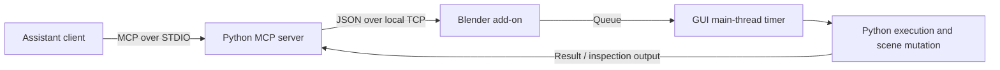

# Preparation B: Choosing a code-driven Blender research route

**Investigation date:** 15 September 2026.  
**Baseline:** Installed Blender 5.2.2 LTS, source `d13f752e3b9c4f8c261cda552b1021f8bcc0382c`; see [Preparation A](PREPARATION_A_TECHNICAL_BASELINE.md).  
**Disposition:** Comparative preparation complete. The deep-dive target remains yours to select.

## 1. Recommendation

**Recommended primary target: native Blender Python, authored as external scripts and executed in a fresh background Blender process, with saved files and conventional renders as inspection outputs.**

This gives the subsequent investigation a small, coherent subject: how Python constructs and revises Blender data, how Blender evaluates that data, and how the result is saved and inspected. Its implementation and examples are available at the exact installed release commit. It requires no third-party Blender bridge and no second Blender runtime.

**Strongest alternative: native Python applied to a persistent GUI session through Blender MCP.** Choose this if maintaining and interactively revising one visible scene is more important than isolating each run. It deserves a separate deep dive because connection lifecycle, scheduling, partial mutations, observation, and server/add-on compatibility become part of the correctness question.

These are research recommendations, not measured rankings of model quality or rendering performance. No generated modeling code or integration was run. The native recommendation follows from your objective of testing code-driven design while minimizing the number of systems that must first be understood. [Native workflow guidance](https://github.com/blender/blender/blob/d13f752e3b9c4f8c261cda552b1021f8bcc0382c/doc/python_api/rst/info_tips_and_tricks.rst), [inspected bridge](https://github.com/ahujasid/blender-mcp/tree/7684c6b3ad2aa0710bbdb1cb06b497c90899ae00).

## 2. The conceptual distinction that organizes the comparison

Three choices should be made separately:

1. **Construction interface:** direct data manipulation, mesh-editing operations, user-facing operators, and node-graph construction.
2. **Execution host:** Blender's embedded Python interpreter or Blender imported into an external Python process.
3. **Control mechanism:** manual script execution, a command-line process, an editor integration, or a persistent bridge.

Geometry Nodes is a construction/evaluation system, not a replacement execution host. An external script, an add-on, or an MCP command can each build the same node graph.

### Terms used in this report

| Term | Meaning in this investigation |
|---|---|
| `bpy` | Blender's Python module for accessing application data and behavior |
| Data-block / ID | A Blender-managed entity such as a mesh, material, object or scene. An object can reference a mesh data-block rather than contain unique geometry |
| `bpy.data` | Access to the application's data-block collections |
| `bpy.context` | The current window/editor/selection/data context. Availability depends on how and where code runs |
| Operator / `bpy.ops` | A callable Blender tool, often also exposed through the UI. Preconditions and affected data commonly come from context |
| RNA | Blender's runtime property/type interface through which much of its data is exposed to Python |
| Dependency graph | The evaluation machinery that resolves dependencies such as transforms, constraints, modifiers and animation |
| BMesh | A mesh-editing representation with connectivity and topology operations; its owned data and lifetime differ from an ordinary persistent mesh |
| Node tree | A data-block holding nodes, sockets and links. Geometry and shader trees describe computations Blender evaluates |
| Background / headless execution | Execution without Blender's ordinary application window; it does not mean that all graphics APIs or all operators work |
| MCP | Model Context Protocol: the client-facing interface through which an assistant calls a bridge's tools |
| STDIO | Standard input/output streams connecting a client to a child server process |
| TCP socket | A network-stream connection; Blender MCP uses one locally between its MCP server and Blender add-on |
| Wheel / ABI | A prebuilt Python package / the binary interface it requires; relevant to selecting an external `bpy` package |

These distinctions are grounded in the [data reference](https://docs.blender.org/api/5.2/bpy.data.html), [context reference](https://docs.blender.org/api/5.2/bpy.context.html), [operator guide](https://github.com/blender/blender/blob/d13f752e3b9c4f8c261cda552b1021f8bcc0382c/doc/python_api/rst/info_gotchas_operators.rst), [BMesh reference](https://docs.blender.org/api/5.2/bmesh.html), and [node-tree reference](https://docs.blender.org/api/5.2/bpy.types.NodeTree.html).

## 3. Comparative result

| Route | Process and state ownership | Feedback and iteration | Main extra obligation | Position |
|---|---|---|---|---|
| Script in Blender's Text Editor or console | Existing Blender process owns scene and embedded Python | Immediate scene inspection after execution; can edit the current file | Track selection, modes, module caches and prior mutations | Useful native companion |
| Background Blender command | New Blender process owns one application state per invocation | Save a file/render/log, inspect, revise script, rerun | Explicit inputs, failure detection and output handling | **Primary recommendation** |
| External `bpy` | External Python process loads Blender's native runtime | Convenient integration with an existing Python program/IDE | Separate runtime, ABI and dependency compatibility | Viable, but adds a second baseline |
| Custom add-on | Registered Python code inside Blender | Persistent tools, parameters and UI integration | Registration, cleanup, events and data lifetime | Defer until custom interaction is required |
| Blender MCP | Assistant client → MCP process → add-on in GUI Blender | Tool-based inspection and visible scene editing | Two-component lifecycle, transport, scheduling and observation policy | **Strongest alternative** |
| VS Code Blender Development | Editor launches/instruments Blender | Breakpoints, script commands and add-on reload | Debugger/HTTP dependencies and persistent development setup | Tooling adjunct |
| BlenderProc | Usually launches managed/custom Blender; also exposes an external-`bpy` path | Scene pipelines and dataset outputs | Wrapper assumptions and runtime-version policy | Better suited to dataset production |
| BlenderSynth | Wrapper can relaunch the script under Blender | Rendering/compositor conveniences and dataset workflows | Wrapper support boundary and process/error semantics | Defer for this design study |
| `fake-bpy-module` | Editor/type-analysis environment | Completion/type information | Stub version must match the target API | Optional authoring aid, not execution |

The table is a synthesis of the source evidence in the following sections. “Defer” means that a candidate adds work without a demonstrated benefit for the current research objective; it is not a finding that the tool is generally poor.

### Feedback, recovery and reproducibility across routes

The following is an architectural comparison, not results from local trials. “Rebuild” means executing the construction script again; “reopen” means restoring a saved `.blend` file, Blender's editable scene container. Neither operation guarantees restoration of arbitrary Python globals, external resources or add-on state.

| Route | Inspection and debugging | Error recovery and editable output | Dependencies and reproducibility |
|---|---|---|---|
| Script inside Blender | Read data through `bpy`; inspect the viewport; print diagnostics or trace exceptions. Synchronous execution occupies the application thread | Scene mutations can precede an exception. Preserve a saved checkpoint or rebuild; do not assume script execution is one undoable transaction. Save `.blend` explicitly | Pin Blender and script dependencies; account for current scene, loaded modules and user configuration |
| Background script | Capture standard output/error and exit status; write numeric scene summaries and ordinary renders for the assistant to inspect | Terminate/restart the process and rebuild or reopen a checkpoint. A fresh process cannot undo files already written | Use the verified executable, explicit inputs and output locations; pin external files, dependencies and relevant random seeds |
| Standalone `bpy` | Host Python debugging and data queries; explicitly write rendered feedback | Restart the host process or load a saved scene. Reloading the module is unsupported | Pin wheel, CPython ABI and host packages; separately qualify graphics behavior. `.blend` output remains available through Blender's API |
| Custom add-on | Live scene access and application UI; diagnostics must account for callbacks and registration | Recover scene state separately from unregistering/reloading code; persistent handlers need explicit cleanup | Pin Blender and add-on code, dependency installation and registration behavior |
| Blender MCP | Structured tools, arbitrary-code results and viewport screenshots; client/server/Blender logs span three locations | A timeout is not a rollback receipt. Inspect state before retrying; use saved checkpoints for scene recovery | Pin server and add-on together, interpreter/dependencies, client settings and telemetry policy; saving a scene does not save the transport session |
| VS Code integration | Adds breakpoints, debugger attachment, script commands and add-on reload | Debugger disconnection or code reload need not clear scene mutations; reopen/rebuild independently | Editor extension, debugger/HTTP packages and user-script installation become additional state |
| BlenderProc / BlenderSynth | Add pipeline-oriented render outputs and debugging launch modes | Rerun a controlled pipeline after failure; no generic transaction guarantee. Request editable scene saving explicitly when needed, rather than treating images or HDF5 as a scene | Pin wrapper plus the Blender runtime it actually launches; their documented/default versions do not establish 5.2.2 support |

All execution routes can use procedurally created geometry, materials and lighting without diffusion generation or downloaded finished models. That is an available workflow, not a claim about every wrapper example. Native Python access is shared, but an operator or graphics operation can still require a context or event environment absent from a particular host. The versioned native guides and individual integration sources below support these distinctions.

## 4. Native execution: what is actually shared and what changes

### 4.1 Running a script inside Blender

Blender embeds Python and supports a Text Editor's **Run Script**, an interactive console, and file-based script execution. The same underlying scene data survives successive edits because Blender remains running. Imported modules also remain cached unless explicitly reloaded. Reloading code does not itself reset scene data.

An external editor can remain the authoring interface; Blender's own guidance describes executing an external file and reloading a module. This requires no third-party modeling framework. [API overview](https://github.com/blender/blender/blob/d13f752e3b9c4f8c261cda552b1021f8bcc0382c/doc/python_api/rst/info_overview.rst), [external-editor guidance](https://github.com/blender/blender/blob/d13f752e3b9c4f8c261cda552b1021f8bcc0382c/doc/python_api/rst/info_tips_and_tricks.rst).

**Source trace:** `BPY_run_text` and `BPY_run_filepath` both delegate to `python_script_exec`. That implementation sets the context, prepares a Python namespace, executes code, handles exceptions, restores the prior main module, and flushes output. A shared executor does not make the calling context or persistent scene history identical. [Pinned implementation, lines 125 - 254](https://github.com/blender/blender/blob/d13f752e3b9c4f8c261cda552b1021f8bcc0382c/source/blender/python/intern/bpy_interface_run.cc#L125).

A long synchronous script can prevent ordinary UI response until it finishes. Blender documents modal operators, handlers and timers for event-oriented work. A bridge does not automatically remove that constraint. [State/update and UI guidance](https://github.com/blender/blender/blob/d13f752e3b9c4f8c261cda552b1021f8bcc0382c/doc/python_api/rst/info_gotchas_internal_data_and_python_objects.rst).

### 4.2 Background command-line execution

An illustrative invocation, **not executed in this study**, is:

```sh
/Applications/Blender.app/Contents/MacOS/Blender \
  --background \
  --factory-startup \
  --disable-autoexec \
  --python-exit-code 1 \
  --python /absolute/path/scene.py \
  -- [script-specific arguments]
```

| Element | Exact role |
|---|---|
| Absolute executable path | Selects the verified installation rather than whichever executable a shell finds by name |
| `--background` | Runs without the ordinary Blender window |
| `--factory-startup` | Skips the user's startup scene; useful for controlling initial state, but not a complete dependency/environment specification |
| `--disable-autoexec` | Disables automatic Python execution such as applicable startup scripts/drivers; it does not prohibit the explicit script passed below or sandbox that script |
| `--python-exit-code 1` | Requests a nonzero process exit when a command-line Python script raises an unhandled exception; placed before the script so it is in force |
| `--python /absolute/path/scene.py` | Executes that file through Blender's Python integration |
| `--` | Ends Blender's own option parsing; following arguments are left for the script |
| `[script-specific arguments]` | An explanatory placeholder, not literal syntax or a built-in Blender option; the script defines and parses these arguments |

Blender processes arguments in order. Loading a scene can replace settings established earlier; error-policy flags placed after execution cannot retroactively affect it. The installed help and the [command-line manual](https://docs.blender.org/manual/en/5.2/advanced/command_line/arguments.html) are the baseline for interpreting a command.

The C++ argument handler calls `BPY_run_filepath`, checks its success value, and exits with the configured Python error code when appropriate. This makes failure policy inspectable rather than relying on whether text containing “Error” appeared. An exit status still says nothing about geometric correctness. [Script handler](https://github.com/blender/blender/blob/d13f752e3b9c4f8c261cda552b1021f8bcc0382c/source/creator/creator_args.cc#L2721), [error-code handler](https://github.com/blender/blender/blob/d13f752e3b9c4f8c261cda552b1021f8bcc0382c/source/creator/creator_args.cc#L2836).

**Design implication:** a future experiment can make each run's input script, parameters, Blender build and outputs explicit. It should retain failures and avoid confusing an old render with a successful new output. This is an experimental design recommendation, not infrastructure implemented here.

A process restart controls application-state carryover; it does not guarantee bit-identical renders across devices, versions, random seeds or external resources. Startup cost and full rebuild time are the principal expected tradeoffs, and neither was measured.

### 4.3 Data API, operators and mesh construction

Using Python does not mean replaying mouse actions. Direct data operations can target explicit objects. Operators often obtain targets and prerequisites from context, and may return status rather than a newly created object. If an operator's `poll` fails, the relevant source may be needed to identify its precondition. [Operator limitations](https://github.com/blender/blender/blob/d13f752e3b9c4f8c261cda552b1021f8bcc0382c/doc/python_api/rst/info_gotchas_operators.rst).

The inspected `bpy/ops.py` dynamically constructs operator access through the private `_bpy.ops` module. The inspected C++ module delegates callable construction into a separate implementation. Those entry points were traced, but the entire operator system was not audited. [Python dispatch](https://github.com/blender/blender/blob/d13f752e3b9c4f8c261cda552b1021f8bcc0382c/scripts/modules/bpy/ops.py), [C++ module](https://github.com/blender/blender/blob/d13f752e3b9c4f8c261cda552b1021f8bcc0382c/source/blender/python/intern/bpy_operator.cc).

BMesh exposes topology operations and permits independently owned mesh-editing instances. The script must transfer results into a persistent mesh when appropriate and maintain valid topology/selection state. This is a useful construction surface for a focused study; it is not an alternative to running Blender. [BMesh reference](https://docs.blender.org/api/5.2/bmesh.html).

### 4.4 Python-created Geometry Nodes and shader graphs

Python can author a node tree by creating nodes, setting their properties and socket defaults, and connecting output sockets to input sockets through links. The tree's interface describes the inputs and outputs exposed to its users. A Geometry Nodes modifier applies geometry computation to an object; a shader tree describes material computation during shading. These graphs remain editable scene data when saved, whereas a Python script is the authoring procedure that constructed them. [NodeTree reference](https://docs.blender.org/api/5.2/bpy.types.NodeTree.html).

This separates graph construction from graph evaluation. Creating links is not evidence that the result has been evaluated correctly or that a shader is valid for every render engine. Background execution, embedded scripts and a live bridge can each construct these data structures; their context and feedback limitations still apply.

The installed series matters here: the 5.2 migration notes replace the old custom-property access pattern for Geometry Nodes modifier inputs with RNA-based access and describe socket-identifier changes. A graph-building wrapper or copied tutorial must be checked at this boundary before attributing failure to the language model. The preparation inspected the migration notes and NodeTree interface; it did not audit every node type. [5.2 Python API migration notes](https://developer.blender.org/docs/release_notes/5.2/python_api/).

## 5. External Python importing `bpy`

The package loads Blender into the Python process; it does not attach to a separately running Blender window. The verified registry offers a 5.2.2 ARM64 wheel for CPython 3.13.

The official module guide documents important differences: factory-style initial state, one active blend-file state per process, no `importlib.reload(bpy)`, different signal/crash handling, unavailable command-line-only controls, and possible GPU resource conflicts with other modules. [Pinned module guide](https://github.com/blender/blender/blob/d13f752e3b9c4f8c261cda552b1021f8bcc0382c/doc/python_api/rst/info_advanced_blender_as_bpy.rst).

**Assessment:** attractive if Blender must be embedded in an existing numerical/Python application. For the present design experiment, the installed Blender executable already supplies the needed host. Adding the wheel would require another runtime/dependency baseline without first resolving a demonstrated limitation.

The wheel's presence is verified; import success, renderer access and equivalence to the installed application are not. [Package metadata](https://pypi.org/pypi/bpy/5.2.2/json).

## 6. Add-ons and live bridges

### 6.1 Custom add-ons

An add-on registers functionality in Blender rather than merely executing a one-shot file. Registration/unregistration and class lifetime therefore matter. The official overview distinguishes registration from import and notes that loading a new blend file does not simply rerun an add-on's registration. [Registration documentation](https://github.com/blender/blender/blob/d13f752e3b9c4f8c261cda552b1021f8bcc0382c/doc/python_api/rst/info_overview.rst).

An add-on can be entirely procedural Python. It becomes worthwhile when the required product includes persistent interactive controls or specialized tools. Neither is yet required here. Developing a bespoke live bridge would also introduce a protocol and event lifecycle before we know that they improve the experiment.

### 6.2 Blender MCP: inspected identity and architecture

The inspected source is **`ahujasid/blender-mcp` commit `7684c6b3ad2aa0710bbdb1cb06b497c90899ae00`**, dated 15 September 2026. Its package metadata declares version **1.9.4** and external Python requirement **≥3.10**. This is a source snapshot; equivalence to any installed or published package was not tested. Root and bundled copies of `addon.py` are byte-identical in the captured revision. [Package metadata](https://github.com/ahujasid/blender-mcp/blob/7684c6b3ad2aa0710bbdb1cb06b497c90899ae00/pyproject.toml).



STDIO is the assistant-facing connection. The add-on's local TCP protocol is a separate transport; calling everything “MCP” hides this extra boundary.

The add-on rejects `bpy.app.background`, queues received commands and drains them on a main-thread timer. It creates a fresh execution namespace for each submitted code string while retaining the Blender scene. Thus a Python variable from one call is not a reliable variable in the next call, but an object created in the scene can remain. [Add-on source, execution and scheduling](https://github.com/ahujasid/blender-mcp/blob/7684c6b3ad2aa0710bbdb1cb06b497c90899ae00/addon.py#L647).

The timer requests another callback after 0.05 seconds. That is a scheduling interval, **not** a 50 ms response-time guarantee. Blender's timer implementation interprets a callback's number as the next delay and `None` as cancellation. [Blender timer implementation](https://github.com/blender/blender/blob/d13f752e3b9c4f8c261cda552b1021f8bcc0382c/source/blender/python/intern/bpy_app_timers.cc).

### 6.3 Transport, errors and observation

The inspected server serializes send/receive operations on its connection and uses a 180-second socket timeout. It accumulates bytes until a JSON document parses. A viewport screenshot uses a temporary image path written by Blender and read by the server, adding a shared-filesystem assumption to that observation path. [Server connection and screenshot implementation](https://github.com/ahujasid/blender-mcp/blob/7684c6b3ad2aa0710bbdb1cb06b497c90899ae00/src/blender_mcp/server.py).

**Inference:** a tool timeout cannot be treated as proof that a queued scene mutation did not occur. The inspected queue has no transaction rollback tied to the assistant's timeout. Retrying a creation command could therefore duplicate work. This is a credible failure path for a future bridge study, not a reproduced failure on this installation.

The repository contains a deterministic test for splitting multibyte UTF-8 input across socket chunks. It uses a scripted fake socket and inspects queued commands. This is evidence of targeted regression coverage, not evidence of end-to-end Blender 5.2.2 compatibility. The test was read, not run. [Socket regression test](https://github.com/ahujasid/blender-mcp/blob/7684c6b3ad2aa0710bbdb1cb06b497c90899ae00/tests/test_socket_unicode.py).

### 6.4 Code-only operation and host access

The bridge offers code execution separately from model-generation and asset-library integrations. Those additional integrations are not necessary to construct a scene procedurally. A code-only study would exclude their use and classify any example that imports finished models separately. [Capabilities and examples](https://github.com/ahujasid/blender-mcp/blob/7684c6b3ad2aa0710bbdb1cb06b497c90899ae00/README.md#capabilities).

Its optional `BLENDER_MCP_SAFE_MODE=1` setting enables an abstract-syntax-tree validator in the MCP process. The inspected policy permits ordinary modeling/render/save operations and blocks classes of imports and persistent callbacks. It explicitly does not sandbox the Blender process or protect direct access to the add-on socket. No security audit or escape testing was performed. [Safe-mode policy](https://github.com/ahujasid/blender-mcp/blob/7684c6b3ad2aa0710bbdb1cb06b497c90899ae00/src/blender_mcp/safe_mode.py).

Telemetry is a material configuration issue: the add-on's consent property defaults to true. The telemetry implementation distinguishes withholding content from disabling telemetry altogether; the latter is controlled by environment variables such as `DISABLE_TELEMETRY=true`. This value instructs the bridge to disable its telemetry; it was inspected, not configured or tested. [Consent default](https://github.com/ahujasid/blender-mcp/blob/7684c6b3ad2aa0710bbdb1cb06b497c90899ae00/addon.py#L4203), [telemetry implementation](https://github.com/ahujasid/blender-mcp/blob/7684c6b3ad2aa0710bbdb1cb06b497c90899ae00/src/blender_mcp/telemetry.py).

### 6.5 ChatGPT/Codex integration requirements

Official OpenAI documentation distinguishes remote tools available to ChatGPT web from local MCP processes that a Codex host can start. It documents both STDIO and Streamable HTTP server support. A repository's statement that it connects to an LLM does not mean every ChatGPT surface can directly connect to a local Blender socket.

For local MCP registration, the documented command shape is `codex mcp add <server-name> -- <server-command>`: `mcp add` registers a server, the name identifies that registration, and `--` separates Codex's arguments from the command it will launch. Registration changes configuration and was not performed.

The official documented default tool timeout is 60 seconds, distinct from this bridge's 180-second socket setting. That discrepancy is a configuration question, not a measurement of either timeout in the current client. [Official OpenAI MCP documentation](https://developers.openai.com/codex/mcp).

By comparison, a local coding agent with permitted process/file access can invoke the Blender executable and inspect written outputs without adding an MCP bridge. This task demonstrated that local access for version/help diagnostics only; it did not demonstrate automated modeling.

## 7. Wrappers and development integrations

### 7.1 VS Code Blender Development

Inspected revision: `d30e14bc6f13e61247ccc2bd89f1a0116b5cf8db`; package version **0.0.31**. The current README says active feature development has stopped, although the repository still shows maintenance commits. “Maintained” should therefore not be interpreted as a promise of current-version compatibility. [Pinned README](https://github.com/JacquesLucke/blender_vscode/blob/d30e14bc6f13e61247ccc2bd89f1a0116b5cf8db/README.md).

The integration adds debugger attachment, script execution and add-on reloading. `Blender: Start` launches an instrumented application; `Blender: Run Script` sends a script to a managed session; `Blender: Reload Addons` reloads registered development code. These are editor command names, not shell commands.

The startup/communication code uses **debugpy**, a Python debugger interface, and **Flask/Werkzeug**, an HTTP server layer. The installer places missing dependencies into Blender's user script-module directory. These are concrete persistent setup effects, not just syntax highlighting. [Startup](https://github.com/JacquesLucke/blender_vscode/blob/d30e14bc6f13e61247ccc2bd89f1a0116b5cf8db/pythonFiles/launch.py), [communication](https://github.com/JacquesLucke/blender_vscode/blob/d30e14bc6f13e61247ccc2bd89f1a0116b5cf8db/pythonFiles/include/blender_vscode/communication.py), [dependency installation](https://github.com/JacquesLucke/blender_vscode/blob/d30e14bc6f13e61247ccc2bd89f1a0116b5cf8db/pythonFiles/include/blender_vscode/installation.py).

**Assessment:** useful if breakpoint debugging becomes a priority. It is not the smallest starting surface for investigating model-written geometry.

### 7.2 BlenderProc

Inspected revision: `76bd8b82ee19489843578ff045298642197bf883`. Its documented emphasis is procedural rendering and synthetic datasets: images plus depth, normals and labels, often written into HDF5 containers. HDF5 is structured scientific-data storage, not Blender's editable scene format. [Project overview](https://github.com/DLR-RM/BlenderProc/blob/76bd8b82ee19489843578ff045298642197bf883/README.md).

`blenderproc run script.py` starts the pipeline through the wrapper's command line. `debug` instead opens its interactive inspection workflow. The source also has an external-`bpy` mode selected by `USE_EXTERNAL_BPY_MODULE`; its run commands explicitly instruct users to invoke Python directly in that mode. This is more nuanced than the README's broad statement that BlenderProc must use its command line. [Command-line implementation](https://github.com/DLR-RM/BlenderProc/blob/76bd8b82ee19489843578ff045298642197bf883/blenderproc/command_line.py).

The default installation path selects Blender **4.2.1**. A custom Blender path is supported, but accepting a path does not establish API compatibility with 5.2.2. [Installation/version selection](https://github.com/DLR-RM/BlenderProc/blob/76bd8b82ee19489843578ff045298642197bf883/blenderproc/python/utility/InstallUtility.py#L88).

**Assessment:** reconsider for large synthetic datasets or annotation pipelines. It adds a different default Blender version and dataset-oriented abstractions to the present design investigation.

### 7.3 BlenderSynth

Inspected revision: `02a8c7b92ff3332639db6b8a6e3df742d9e76b00`; package metadata version **0.3.2**. Its README describes a beta synthetic-dataset library and states support for Blender 3 and 4. That does not establish support for 5.2.2. [README](https://github.com/ollieboyne/BlenderSynth/blob/02a8c7b92ff3332639db6b8a6e3df742d9e76b00/README.md).

Its `run_this_script(open_blender=False)` convenience function can launch the calling script in a separate background Blender process. Setting `open_blender=True` omits that background flag; it does not attach to an arbitrary existing Blender session. The source also transfers Python search-path information and optionally attaches a debugger. [Launcher implementation](https://github.com/ollieboyne/BlenderSynth/blob/02a8c7b92ff3332639db6b8a6e3df742d9e76b00/blendersynth/run/run_this_script.py).

**Assessment:** its render/compositor conveniences are concrete, but the current support boundary and dataset focus make it a weaker target than native scripting.

### 7.4 Completion stubs

Inspected `fake-bpy-module` revision: `eea267aaca080e05114e2b8158ae9831db274c52`. The project supplies editor completion/type information and lists a 5.2-specific package. Its unversioned latest package follows development builds. These modules do not supply Blender's modeling runtime. Versioned stubs could assist authoring later, but cannot prove that a script runs correctly. [Project documentation](https://github.com/nutti/fake-bpy-module/blob/eea267aaca080e05114e2b8158ae9831db274c52/README.md).

## 8. Representative examples and firsthand reports

### 8.1 Examples inspected as source

| Example | What its source establishes | What it does not establish |
|---|---|---|
| Blender's `background_job.py` | Direct creation of text, camera and light; argument parsing; explicit update; optional save/render | Arbitrary-object modeling quality, runtime speed, or robustness against all bad inputs |
| Blender's `bmesh_simple.py` | Convert a selected mesh to BMesh, move vertices, write back, free the temporary mesh | Selection-free reusable modeling logic; the example assumes an active mesh |
| BlenderProc quickstart in README | Construct a built-in mesh, light and camera, render and write dataset output | An independently designed object or 5.2.2 compatibility |
| BlenderProc basic example | Import an existing OBJ, use camera poses, render multiple data channels | Code-only construction of the imported geometry |
| BlenderSynth quickstart | Build from a built-in primitive, configure material/light/compositor, render | A complex authored shape or 5.2 support |
| Blender MCP's example list | Separates procedural commands from explicit asset imports and external generation | That every showcased scene was made solely by code, without unreported intervention |

[Background example](https://github.com/blender/blender/blob/d13f752e3b9c4f8c261cda552b1021f8bcc0382c/scripts/templates_py/background_job.py), [BMesh example](https://github.com/blender/blender/blob/d13f752e3b9c4f8c261cda552b1021f8bcc0382c/scripts/templates_py/bmesh_simple.py), [BlenderProc basic](https://github.com/DLR-RM/BlenderProc/blob/76bd8b82ee19489843578ff045298642197bf883/examples/basics/basic/main.py), [BlenderSynth quickstart](https://github.com/ollieboyne/BlenderSynth/blob/02a8c7b92ff3332639db6b8a6e3df742d9e76b00/examples/quickstart.py).

No example was executed. Demo videos were not watched or transcribed in this preparation, and no conclusion about their visual quality is claimed.

### 8.2 Firsthand experience checked against source

| Report | Evidence and qualification | Consequence for selection |
|---|---|---|
| [MCP #251](https://github.com/ahujasid/blender-mcp/issues/251), May 2026 | Author reports background-server hangs on Linux/Blender 5.1.2, plus success with a fork. The proposed worker-thread workaround is not established safe by that report | Do not conflate native background scripts with this bridge's supported lifecycle |
| [MCP PR #272](https://github.com/ahujasid/blender-mcp/pull/272), June 2026 | API metadata verifies merge on 11 June; current source refuses background startup | The resolution was explicit rejection, not implementation of headless bridge support |
| [MCP #279](https://github.com/ahujasid/blender-mcp/issues/279), July/August 2026 | Windows users report long round trips even for small commands; revisions are insufficiently precise. Related framing PR #292 was closed unmerged | Historical evidence of transport/diagnostic problems, not a measured defect in the inspected September build |
| [MCP #314](https://github.com/ahujasid/blender-mcp/issues/314), August 2026 | Report lacks exact package versions and names some tools not matching this inspected server | Weak attribution: retain as a lead, not decisive evidence against this revision |
| [MCP #207](https://github.com/ahujasid/blender-mcp/issues/207), March 2026 | Reporter identifies unrestricted execution. Current source has an optional MCP-side validator but still documents direct socket execution outside that guard | Evaluate actual execution boundaries rather than repeat the historical claim that no validator exists |
| [VS Code #260](https://github.com/JacquesLucke/blender_vscode/issues/260), February 2026 | Linux user reports a debugger-attachment stall with 5.0.1; maintainer questions script versus add-on workflow. No verified resolution in captured discussion | Setup and workflow matter; not proof that 5.2.2 fails |

These are issue reports, not a representative satisfaction survey. Maintainer-authored documentation and promotional examples have different evidentiary weight from independent experience. User reports were selected for concrete implications for route selection, not to maximize complaint counts.

## 9. Proposed narrow boundary for the deep dive

### Recommended target

**“Native procedural scene construction and revision in Blender 5.2.2 using Python, with controlled background execution.”**

Keep the investigation within:

- Direct object/mesh/curve data access, BMesh and the necessary operator/context boundary.
- Transforms, dependency evaluation, modifiers and lifecycle of references.
- Python construction of a bounded set of geometry/shader nodes where they materially support design.
- Materials, camera and lighting setup sufficient to inspect geometry through conventional rendering.
- Script inputs, process errors, saving/reopening and export semantics.
- Source/documentation at the verified Blender commit; published 5.2 references cross-checked when a version-sensitive question arises.

Exclude custom add-on development, live transport implementations, wrapper internals, dataset annotation, complex character rigging, physics pipelines, and exhaustive renderer internals from that first study. These are proposed boundaries, not silently adopted omissions.

### If you select the live alternative

Center the study on Blender 5.2.2 plus the pinned Blender MCP revision: full core documentation, server/add-on execution paths, scheduling, scene lifetime, tool results, cancellation/timeouts, screenshot handling, telemetry controls and code-only configuration. Treat geometry construction as a bounded workload and comparison point.

### Questions the next study must resolve

1. Which creation and revision operations can use explicit data references, and which need operators or evaluated context?
2. What invariants must hold before saving or inspecting a result?
3. Which code/state must persist for a precise revision, and which should be rebuilt?
4. How are failed or partially completed runs recognized without mistaking stale output for success?
5. Which 5.2 API changes invalidate common examples?
6. What later capability test would distinguish correct construction, visual appeal, and controlled revision?

A complete reading corpus and source-path specification will be produced **after your target selection**, as the approved preparation plan requires.

## 10. Completion and limits

All requested execution categories have been compared; representative maintained or recently maintained integrations were examined where they change execution, debugging or output workflows. This is not a census of every Blender wrapper or an exhaustive security/performance audit.

The recommendation is grounded in exact-version documentation/source, inspected examples, issue-resolution checks and the verified local baseline. Only diagnostic execution and the separately authorized application update occurred. No claims of local modeling capability, renderer speed, bridge reliability or wrapper compatibility have been promoted from documentation alone.

See [source coverage](SOURCE_COVERAGE.md) for the distinction between full reading, targeted inspection, metadata lookup and captured-but-unread material.
